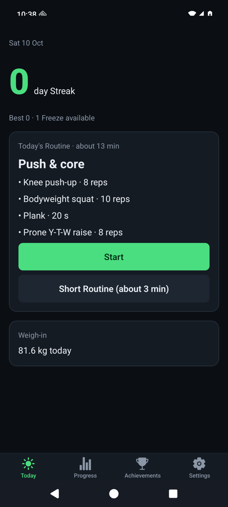
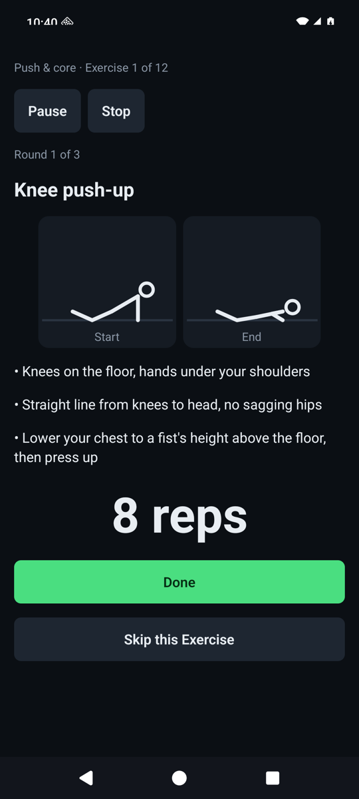
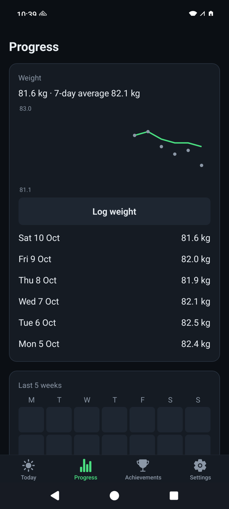

# Daily Calisthenics

**A 12-minute bodyweight routine every morning — no gym, no account, no excuses.**

Daily Calisthenics is a small, free Android app that tells you exactly what to do each morning: a short guided circuit with simple illustrations, reps or a timer for every move, and a Streak that forgives the occasional bad day.

  
  
  

## Features

- **Guided Sessions**: Warm-up, then 3 Rounds of 4 Exercises with countdowns, beeps and vibration. About 12 minutes.
- **Starts where you are**: three questions place you on each Progression (wall push-ups to diamond push-ups, and more). Floor and a chair are all you need.
- **Gets harder as you do**: rate each Exercise *too easy / OK / too hard* and the app suggests more reps or the next Step.
- **Bad day? Short Routine**: a 3-minute version still keeps your Streak alive, and a weekly Freeze covers a missed day.
- **Weigh-ins**: one tap after your Session, with a 7-day average chart.
- **Achievements and Reminders** to keep you coming back.
- **Private**: everything stays on your phone. Export a backup file whenever you like.

## Install

1. On your Android phone, open the [latest release](https://github.com/Meuss/daily-calisthenics/releases/latest) and download `daily-calisthenics-<version>.apk`.
2. Open the downloaded file. Android will ask you to allow installs from your browser or Files app — allow it for this install.
3. If Play Protect warns that it doesn't recognise the app, choose **Install anyway** (it isn't on the Play Store).

Updates: install the newer APK from Releases the same way; your history stays on the phone. Export a backup from Settings first if you like.

### Try it without installing

On a computer with Node.js and pnpm: `git clone https://github.com/Meuss/daily-calisthenics && cd daily-calisthenics && pnpm install && pnpm start`, then scan the QR code with Expo Go for SDK 57 ([expo.dev/go](https://expo.dev/go)). Expo Go can't schedule notifications, so morning Reminders only work in the installed app.

## Development

    pnpm install
    pnpm test           # unit tests (domain rules and app logic)
    pnpm typecheck
    pnpm check:bundle   # builds the Android JS bundle

- Vocabulary: [`CONTEXT.md`](CONTEXT.md) · Design: [`docs/superpowers/specs/2026-10-10-daily-calisthenics-design.md`](docs/superpowers/specs/2026-10-10-daily-calisthenics-design.md)
- Manual test pass on a phone: [`docs/device-checklist.md`](docs/device-checklist.md)

## License

[MIT](LICENSE)
